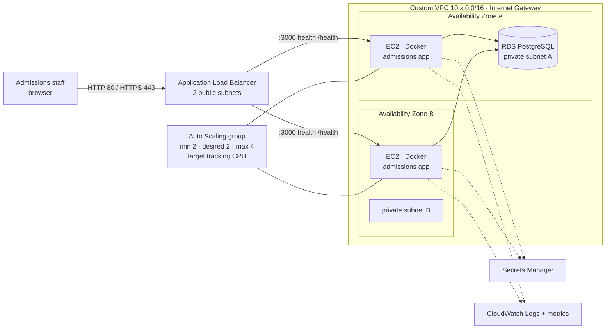

# CFS Admissions — AWS High-Availability Architecture

How the admissions system runs on AWS in the Academy Learner's Lab, why instances are interchangeable, and how to demonstrate it. Step-by-step deployment commands are in [README.md](README.md); the template is [stack.yaml](stack.yaml).

## 1. Architecture

| Component | Configuration |
| --- | --- |
| VPC | Custom CIDR, Internet Gateway, public subnets for the ALB and web tier in two AZs, private data subnets in two AZs |
| Security groups | ALB: 80/443 from the internet. Web: 3000 from the ALB group only. Database: 5432 from the web group only |
| Application Load Balancer | Internet-facing, both AZs; target group health check `GET /health` |
| Launch template | Amazon Linux 2023, IMDSv2 required (hop limit 1), encrypted gp3 EBS root volume, user data installs Docker, writes the runtime configuration and starts the pinned image with systemd |
| Auto Scaling group | Min 2, desired 2, max 4 across both AZs; ELB health checks; target-tracking policy on average CPU (default 50%) |
| RDS for PostgreSQL | Private subnets, encrypted, the single shared data store |
| Secrets Manager | `DATABASE_URL` and `SESSION_PEPPER`, read at startup with the instance role |
| CloudWatch | Container logs via the `awslogs` driver (one stream per instance ID); EC2 and ASG metrics drive scaling |

No S3 bucket is needed: the admissions system stores no files, and the institution logo is kept in the database.

## 2. Why any instance can serve any request

| Concern | Where it lives |
| --- | --- |
| Applicants, applications, programmes, intakes, notes, history, settings, activity | PostgreSQL |
| Sessions and CSRF tokens | PostgreSQL `sessions` table (cookie holds only a random token) |
| Login rate limiting | PostgreSQL `login_limits`, so limits are not multiplied by instance count |
| Capacity and concurrent edits | Row locks and version checks in PostgreSQL transactions |
| Configuration | Environment variables plus Secrets Manager; identical for every instance |
| Instance identity | Read from IMDSv2 by user data at boot (or by the server with `INSTANCE_METADATA=imds`) and kept server-side |

Nothing authoritative is stored on the instance or its EBS volume, so the Auto Scaling group can terminate and replace instances freely. A replacement boots from the launch template, pulls the same image, reads the same secret and joins the target group once `/health` passes.

## 3. Health checks and instance identification

- `GET /health` is cheap and does not touch the database, so a slow database does not mark every instance unhealthy at once. Each call records the "last load-balancer health check" time shown on Infrastructure Status.
- `GET /health/ready` checks the database within 1 second (use it in smoke tests and after deployments).
- `GET /api/infrastructure/instance` and the `X-Served-By` header report the serving instance and zone. The browser never talks to the metadata service, and no token, credential or private configuration is returned.
- Locally, these fields read "Local development" or "Unavailable"; nothing is simulated.

## 4. Demonstration checklist

| # | Evidence | How |
| --- | --- | --- |
| 1 | Two healthy targets in two AZs | Target group → Targets; EC2 list with the AZ column |
| 2 | Requests are load balanced | Infrastructure Status → **Sample 10 requests** shows two instance IDs, or run `for i in $(seq 10); do curl -s <alb>/api/infrastructure/instance; echo; done` |
| 3 | Shared sessions | Sign in, refresh repeatedly; the serving instance changes and you stay signed in |
| 4 | Self-healing | Terminate one instance; the ASG launches a replacement, the site stays available and data is intact |
| 5 | Scaling | Generate CPU load within the lab budget; the target-tracking policy adds instances, then scales back |
| 6 | Shared data | Create an applicant on one instance; it appears when another instance serves the next request |
| 7 | Logs | CloudWatch log group shows JSON request logs per instance with request ID, route, status and duration |
| 8 | Private database | RDS has no public access; its security group only admits the web group |
| 9 | Student identification | Admin number in the sidebar footer and on Infrastructure Status (`StudentAdminNumber` parameter or Settings) |

## 5. Learner's Lab notes

- Use the lab's `LabInstanceProfile`; the template does not create IAM roles.
- Use `t3.micro` or `t3.small` (allowed by the template). The Node service and PostgreSQL client pool are sized for small instances (pool of 10 connections per instance).
- Lab sessions stop instances when they end; the Auto Scaling group restores the desired count when the lab restarts.
- The web tier sits in public subnets with security-group chaining to avoid NAT Gateway cost. For production, move it to private subnets behind NAT or VPC endpoints.
- RDS is single-AZ in the template to stay within lab budgets. Multi-AZ RDS is the production upgrade for database-level availability.
